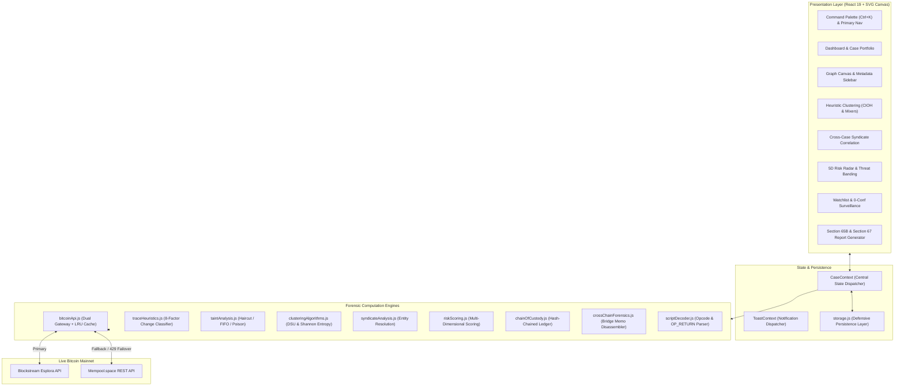
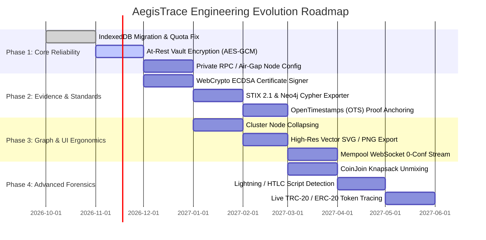

# AegisTrace — Codebase Analysis & Engineering Evaluation

## 1. Executive Overview

**AegisTrace** is a software solution developed in response to the SIH-1675 problem statement for Bitcoin tracing and forensic investigation. It reconstructs and analyzes fund-flow graphs from live public blockchain data and supports case management, review, and report preparation. It is an investigative aid: its heuristics do not establish identity or prove attribution, and its reports are not automatically certified as court-admissible evidence.

Most analysis executes in the browser. Case portfolios and graphs use browser-managed IndexedDB with localStorage migration and a recovery-copy fallback; this does not encrypt data at rest. Watchlists remain in localStorage. Live lookups send queried transaction IDs or addresses to Blockstream or Mempool.space. The current build is neither air-gapped nor query-private and should not be used for sensitive investigations without an approved deployment and privacy controls.

---

## 2. Technology Stack & Runtime Architecture

| Layer | Technology | Operational Function |
|---|---|---|
| **Framework** | **React 19** (`react`, `react-dom`) | Concurrent rendering, declarative component tree, state isolation via React Context. |
| **Routing** | **React Router v7** | Client-side routing across 8 forensic modules (`/dashboard`, `/trace`, `/clustering`, `/syndicate`, `/risk`, `/watchlist`, `/notices`, `/report`). |
| **Build & Tooling** | **Vite 8** + `@vitejs/plugin-react` | Ultra-fast HMR, ES module chunking, and strict tree-shaking. |
| **Iconography & Styling** | **Lucide React** + Glassmorphic CSS | High-contrast law enforcement dark-mode UI; Outfit (UI) + JetBrains Mono (hashes/scripts). |
| **Linter** | **OxLint** | Rust-based high-speed static analyzer (91 rules, zero errors/warnings across 87 files). |
| **Test Runner** | **Vitest 3.2** | Latest full-suite run passed **44 test files and 283 tests**; run `npm run validate` for lint, tests, and production build. |
| **Blockchain Gateways** | **Blockstream.info + Mempool.space** | RESTful Esplora API layer with LRU caching, timeout handling, and automatic circuit-breaking failover. |

---

## 3. Component & Module Breakdown

### Presentation Components (`src/components/`)
* **[Dashboard.jsx](file:///e:/Git%20Repo/Mini-proj/src/components/Dashboard.jsx)**: Global case management dashboard, portfolio metrics (BTC, USD, INR), paste-to-trace search bar with automatic type detection (TxID vs Address vs Hash), and new investigation dialog.
* **[GraphExplorer.jsx](file:///e:/Git%20Repo/Mini-proj/src/components/GraphExplorer.jsx)**: Container for vector graph investigation workspace, pan/zoom controls, and sidebar coordination.
* **[GraphCanvas.jsx](file:///e:/Git%20Repo/Mini-proj/src/components/graph/GraphCanvas.jsx)**: Interactive SVG vector graph with node dragging, Dijkstra critical money trail highlighting, circular flow detection, chronological playback animation, and taint heatmaps.
* **[MetadataSidebar.jsx](file:///e:/Git%20Repo/Mini-proj/src/components/graph/MetadataSidebar.jsx)**: Detailed node inspection showing centrality metrics, endpoint behavioral classification, raw script disassembly, bridge memos, and investigator case notes.
* **[HeuristicClustering.jsx](file:///e:/Git%20Repo/Mini-proj/src/components/HeuristicClustering.jsx)**: Visualizes Common Input Ownership Heuristic (CIOH) clusters, Shannon entropy mixer detection, and chronological peel chain sequences.
* **[SyndicateMap.jsx](file:///e:/Git%20Repo/Mini-proj/src/components/SyndicateMap.jsx)**: Cross-case address overlap analysis that surfaces shared addresses for investigator review; overlap alone does not establish common ownership or criminal association.
* **[RiskAnalyzer.jsx](file:///e:/Git%20Repo/Mini-proj/src/components/RiskAnalyzer.jsx)**: Interactive heuristic risk dimensions and configurable weights for triage, not statutory thresholds or findings of wrongdoing.
* **[WatchlistMonitor.jsx](file:///e:/Git%20Repo/Mini-proj/src/components/WatchlistMonitor.jsx)**: Real-time 0-confirmation mempool surveillance and high-value target wallet monitor.
* **[OSINTIntegrator.jsx](file:///e:/Git%20Repo/Mini-proj/src/components/OSINTIntegrator.jsx)**: Formats formal **Section 67 NDPS Act, 1985** statutory legal freeze notices directed to Indian exchanges (WazirX, CoinDCX, ZebPay, Binance).
* **[ReportGenerator.jsx](file:///e:/Git%20Repo/Mini-proj/src/components/ReportGenerator.jsx)**: Report and certificate-language drafting with a SHA-256 report-payload digest and optional drawn canvas signature. The digest does not authenticate source data; the signature is not a certificate-backed digital signature, and the report is not guaranteed admissible.

### Core Algorithmic Engines (`src/utils/`)
* **[bitcoinApi.js](file:///e:/Git%20Repo/Mini-proj/src/utils/bitcoinApi.js)**: Recursive breadth-first search (BFS) forward tracer with bounded concurrency (5 concurrent requests), LRU caching (5-minute TTL), circuit breaker failover, and endpoint profiling.
* **[traceHeuristics.js](file:///e:/Git%20Repo/Mini-proj/src/utils/traceHeuristics.js)**: 8-factor weighted change-vs-payment classifier (Script consistency, address reuse, roundness/peel share, output position, dwell timing, fingerprinting, fee market, and single-output identity).
* **[taintAnalysis.js](file:///e:/Git%20Repo/Mini-proj/src/utils/taintAnalysis.js)**: Taint propagation engine supporting three accounting conventions: **Proportionate / Haircut**, **FIFO (First-In, First-Out)**, and **Poison (100% Contamination)** via fixed-point iterative relaxation.
* **[clusteringAlgorithms.js](file:///e:/Git%20Repo/Mini-proj/src/utils/clusteringAlgorithms.js)**: Disjoint Set Union (DSU) with path compression for $O(\alpha(N))$ address clustering; Shannon entropy calculation for Wasabi/Whirlpool mixing detection.
* **[syndicateAnalysis.js](file:///e:/Git%20Repo/Mini-proj/src/utils/syndicateAnalysis.js)**: Cross-case entity resolution indexing addresses to cases, weighting shared terminal cash-out endpoints.
* **[crossChainForensics.js](file:///e:/Git%20Repo/Mini-proj/src/utils/crossChainForensics.js)**: Disassembles cross-chain bridge memos (THORChain, Maya, SideShift, ChangeNOW) and extracts target secondary addresses on Ethereum, Tron, and Solana.
* **[chainOfCustody.js](file:///e:/Git%20Repo/Mini-proj/src/utils/chainOfCustody.js)**: SHA-256 event chain; it is not signed or externally anchored and is not a trusted evidentiary seal.
* **[scriptDecoder.js](file:///e:/Git%20Repo/Mini-proj/src/utils/scriptDecoder.js)**: Bytecode disassembler for Bitcoin opcodes, script templates (P2PK, P2PKH, P2SH, SegWit, Taproot), and ASCII `OP_RETURN` payload extraction.
* **[traceVerification.js](file:///e:/Git%20Repo/Mini-proj/src/utils/traceVerification.js)**: Mathematical assurance engine verifying value conservation invariants, seed pinning, and FIFO anti-minting guarantees.

---

## 4. Verification & Test Suite Status

The latest full-suite run passed **44 test files and 283 tests**.
Run `npm run validate` for a fresh lint, test, and production build result; a
passing suite does not establish real-world forensic accuracy or legal
admissibility and does not query live gateways.

The offline heuristic fixtures (`npm run verify`) are regression examples, not held-out ground truth or empirical accuracy estimates. The source-corroborated first person-to-person transaction case is exercised by `npm run verify:ground-truth`: its output scripts and values were checked against Blockstream, while Bitcoin.com's published address/role labels are secondary-source claims. The evaluator reports output and payment/change agreement, a payee-candidate check, and observed intermediate/end-receiver path roles (using spend-edge outpoint provenance and UTXO status). These do not identify a person or establish ownership. The single historical case is a regression check, not an accuracy estimate or proof of generalization; the judicial ground-truth set remains empty.

---

## 5. Comprehensive System Evaluation & Strategic Recommendations

A forensic and software engineering audit of the codebase yielded the following concrete enhancement opportunities:

### 1. Storage & Persistence Architecture (High Impact)
* **Finding**: Case data is stored in browser-managed IndexedDB without at-rest encryption. On IndexedDB failure, the app attempts a localStorage recovery copy and reports storage degradation; recovery remains subject to browser storage limits. Public gateway lookups also disclose the requested transaction IDs or addresses to those providers.
* **Recommendation**: 
  - **Completed**: Migrate case portfolios and node graphs to native **IndexedDB**, preserving legacy localStorage data and reporting storage failures.
  - Implement client-side **AES-GCM-256** at-rest encryption for stored dossiers using an investigator master PIN/passphrase derived with `PBKDF2`.

### 2. Forensic De-anonymization Depth
* **Finding**: [`src/utils/clusteringAlgorithms.js`](file:///e:/Git%20Repo/Mini-proj/src/utils/clusteringAlgorithms.js) calculates Shannon entropy to detect CoinJoins and halts to prevent false cluster pollution, but does not deconstruct partial mixers.
* **Recommendation**:
  - Implement a **Subset-Sum Knapsack solver** to correlate input-output pairs in 2-party CoinJoins and JoinMarket churns where $\sum \text{Inputs} \approx \text{Output}_{\text{mix}} + \text{Output}_{\text{change}} + \text{Fee}$.
  - Add **Lightning Network & Submarine Swap detection**: Inspect script bytecode in [`src/utils/scriptDecoder.js`](file:///e:/Git%20Repo/Mini-proj/src/utils/scriptDecoder.js) for 2-of-2 multisig funding contracts and HTLC `OP_CHECKLOCKTIMEVERIFY` scripts to flag Layer 2 off-ramp hops.
  - Add **Read-Only Multi-Chain Token Explorers**: Link detected bridge destination addresses (Tron TRC-20 USDT and Ethereum ERC-20) to public RPCs (TronGrid / Blockscout) so the money trail does not terminate at the bridge boundary.

### 3. Court Evidence & Interoperability
* **Finding**: [`src/components/ReportGenerator.jsx`](file:///e:/Git%20Repo/Mini-proj/src/components/ReportGenerator.jsx) captures an HTML5 canvas signature and calculates a SHA-256 hash.
* **Recommendation**:
  - Add WebCrypto **ECDSA (P-256) / Ed25519 asymmetric digital signing**: Allow officers to sign Section 65B certificates with their cryptographic keypair or USB hardware security tokens (e-Mudhra / FIPS-140).
  - Implement standardized export formats:
    - **STIX 2.1 JSON**: Enables automated cyber threat intelligence sharing with CERT-In and international law enforcement.
    - **Neo4j Cypher Script (`.cyp`)**: Exports node and relationship definitions for direct ingestion into enterprise graph tools (Neo4j, Maltego, i2 Analyst's Notebook).
  - Add **OpenTimestamps (OTS)** proof generation to anchor case integrity digests immutably into the Bitcoin blockchain.

### 4. Graph Ergonomics & Performance
* **Finding**: Vector SVG rendering in [`src/components/graph/GraphCanvas.jsx`](file:///e:/Git%20Repo/Mini-proj/src/components/graph/GraphCanvas.jsx) is optimal for small graphs, but multi-hop traces with high fan-in/fan-out (100+ nodes) can cause visual clutter and frame rate drops.
* **Recommendation**:
  - Implement **Cluster Input Node Collapsing**: Group 20+ co-spent input nodes into a single expandable cluster badge (e.g., `[Cluster: 20 Inputs, 8.5 BTC]`).
  - Introduce an adaptive Canvas / WebGL fallback renderer when total graph nodes exceed 100.
  - Add one-click **Vector SVG and High-Res 300 DPI PNG export** stamped with case metadata and custody hashes for court exhibits.

### 5. Real-Time Operational Surveillance
* **Finding**: [`src/components/WatchlistMonitor.jsx`](file:///e:/Git%20Repo/Mini-proj/src/components/WatchlistMonitor.jsx) relies on periodic HTTP polling.
* **Recommendation**:
  - Implement a WebSocket connection (`wss://mempool.space/api/v1/ws`) for sub-second push notifications of unconfirmed transactions touching suspect addresses.
  - Provide a **Batch Address Ingestion Tray** on the Dashboard to process bulk CSV lists of suspect addresses obtained from seized devices or warrants.

---

## 6. Phased Implementation Roadmap

---
*Report updated to reflect the current repository; this review is not an independent certification.*
